

<picture>
  <source media="(prefers-color-scheme: dark)" srcset="https://raw.githubusercontent.com/zfrnaa/zfrnaa/output/hero-dark.svg" />
  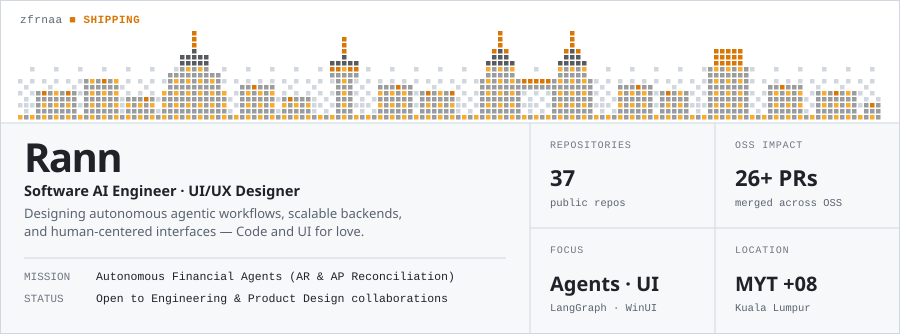
</picture>

### Selected Work

<a href="https://github.com/zfrnaa/deskpilot-agent"><picture><source media="(prefers-color-scheme: dark)" srcset="https://raw.githubusercontent.com/zfrnaa/zfrnaa/output/work-deskpilot-dark.svg" />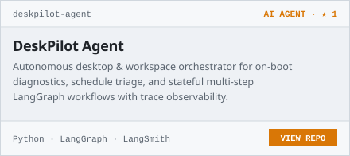</picture></a>&nbsp;<a href="https://github.com/zfrnaa"><picture><source media="(prefers-color-scheme: dark)" srcset="https://raw.githubusercontent.com/zfrnaa/zfrnaa/output/work-5g-dark.svg" />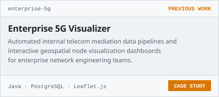</picture></a>

<a href="https://github.com/zfrnaa"><picture><source media="(prefers-color-scheme: dark)" srcset="https://raw.githubusercontent.com/zfrnaa/zfrnaa/output/work-myuthm-dark.svg" />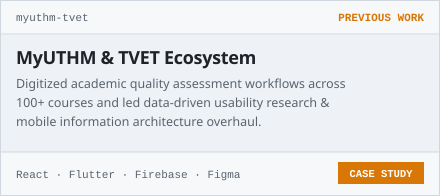</picture></a>&nbsp;<a href="https://github.com/zfrnaa/kursus-git-github"><picture><source media="(prefers-color-scheme: dark)" srcset="https://raw.githubusercontent.com/zfrnaa/zfrnaa/output/work-kursus-dark.svg" />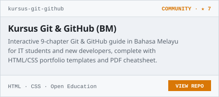</picture></a>

### Open-Source Contributions

<a href="https://github.com/kunkka19xx/look"><picture><source media="(prefers-color-scheme: dark)" srcset="https://raw.githubusercontent.com/zfrnaa/zfrnaa/output/oss-look-dark.svg" />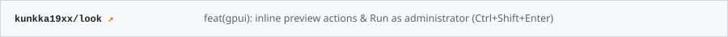</picture></a> <a href="https://github.com/kunkka19xx/lookbook"><picture><source media="(prefers-color-scheme: dark)" srcset="https://raw.githubusercontent.com/zfrnaa/zfrnaa/output/oss-lookbook-dark.svg" />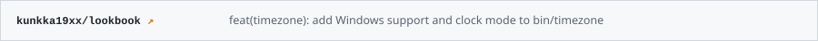</picture></a> <a href="https://github.com/muazhazali/caripasarmalam"><picture><source media="(prefers-color-scheme: dark)" srcset="https://raw.githubusercontent.com/zfrnaa/zfrnaa/output/oss-pasarmalam-dark.svg" />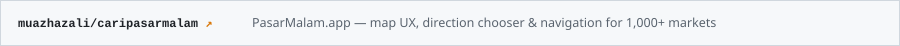</picture></a> <a href="https://github.com/syvixor/skills-icons"><picture><source media="(prefers-color-scheme: dark)" srcset="https://raw.githubusercontent.com/zfrnaa/zfrnaa/output/oss-skills-icons-dark.svg" />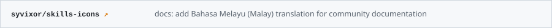</picture></a>

### Tech Stack

<table>
<tr>
<td width="50%" align="center" valign="top">

**Languages, Frontend & Agentic AI**

</td>
<td width="50%" align="center" valign="top">

**Cloud, Databases & DevOps**

</td>
</tr>
<tr>
<td width="50%" align="center" valign="top">

**Design, 3D & Prototyping**

</td>
<td width="50%" align="center" valign="top">

**Workflow, Environment & Tools**

</td>
</tr>
</table>

### Contribution Activity

<picture>
  <source media="(prefers-color-scheme: dark)" srcset="https://raw.githubusercontent.com/zfrnaa/zfrnaa/output/github-snake-dark.svg" />
  
</picture>

<a href="https://www.threads.net/@rann.404"><picture><source media="(prefers-color-scheme: dark)" srcset="https://raw.githubusercontent.com/zfrnaa/zfrnaa/output/link-threads-dark.svg" />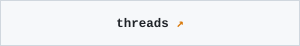</picture></a><a href="mailto:frantajudin@outlook.my"><picture><source media="(prefers-color-scheme: dark)" srcset="https://raw.githubusercontent.com/zfrnaa/zfrnaa/output/link-email-dark.svg" />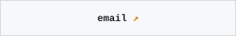</picture></a><a href="https://rannz.rannzaf.workers.dev"><picture><source media="(prefers-color-scheme: dark)" srcset="https://raw.githubusercontent.com/zfrnaa/zfrnaa/output/link-portfolio-dark.svg" />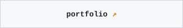</picture></a>

